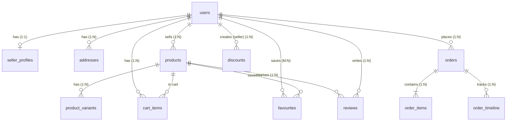
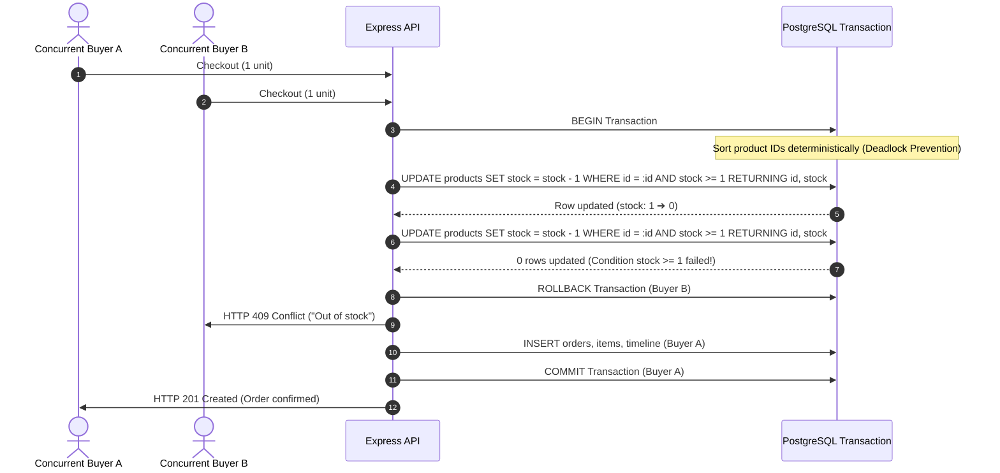

# Atelier Market — PostgreSQL & Docker Edition
> Enterprise-grade multi-vendor e-commerce platform & database migration from MongoDB to PostgreSQL 16.
> Architectural migration from [Atelier Market (MongoDB MVP Edition)](https://github.com/nooremeel/Atelier-Market).

[-10b981?style=for-the-badge&logo=vitest&logoColor=white)](https://github.com/nooremeel/atelier-market-postgres/tree/main/test)
[](https://github.com/nooremeel/atelier-market-postgres/actions/workflows/ci.yml)
[](https://github.com/nooremeel/atelier-market-postgres/tree/main/db)
[](https://github.com/nooremeel/atelier-market-postgres/blob/main/Dockerfile)
[](https://github.com/nooremeel/atelier-market-postgres/tree/main/client)
[](https://github.com/nooremeel/atelier-market-postgres/blob/main/services/paymobService.js)
[](https://github.com/nooremeel/atelier-market-postgres)

---

### 🌐 Live Deployments & Companion Repositories

| Destination | Link | Description |
| :--- | :--- | :--- |
| **Live Production Platform** | [atelier-market-postgres-iota.vercel.app](https://atelier-market-postgres-iota.vercel.app/) | Full-stack deployment (Vercel SPA + Render Docker API + Neon PostgreSQL) |
| **PostgreSQL API Health** | [atelier-market-api.onrender.com/api/health](https://atelier-market-api.onrender.com/api/health) | Live Docker API container health check with active database ping |
| **MongoDB MVP Repository** | [github.com/nooremeel/Atelier-Market](https://github.com/nooremeel/Atelier-Market) | The original document-database MVP edition that initiated this migration |
| **Migration Specification** | [`docs/POSTGRES_MIGRATION.md`](docs/POSTGRES_MIGRATION.md) | Exhaustive 850+ line architectural migration blueprint & engineering guide |
| **Performance Benchmarks** | [`docs/PERFORMANCE.md`](docs/PERFORMANCE.md) | Query plans, index execution analyses, and `EXPLAIN (ANALYZE, BUFFERS)` reports |

---

## 📖 Executive Summary & Migration Backstory

**Atelier Market (PostgreSQL Edition)** is an enterprise-grade multi-vendor e-commerce platform and artisanal marketplace engineered to connect master craft studios across the Middle East with international patrons.

While the original MongoDB implementation provided rapid initial development, scaling a multi-vendor marketplace surfaced real-world document model limitations:
1. **Concurrent Inventory Races:** High-traffic checkouts using unguarded `$inc` updates caused stock overselling and negative balances.
2. **Catalog Search Inefficiencies:** Free-text searches relied on unindexed `$regex` full-collection scans that degraded as inventory grew.
3. **Webhook Non-Idempotency:** Payment webhook retries risked multiple order fulfillments and duplicated stock decrements.
4. **Relational Data Fragmentation:** Storing carts, addresses, and order histories as embedded document arrays led to data duplication and lack of relational integrity constraints.

This repository represents an in-depth **architectural data layer migration from MongoDB (document model) to PostgreSQL 16 (ACID-compliant relational model)**. The backend was re-engineered using raw SQL migrations, Sequelize ORM, deterministic transaction lock ordering, native lexical full-text search with GIN indexing, and multi-stage containerization — **all while preserving 100% of the existing REST API contract and keeping the React frontend completely untouched.**

---

## ⚡ 30-Second Client Demo & Persona Switcher

The application features an instant **1-Click Demo Persona Bar** on `/login` and a persistent demo switcher, allowing technical evaluators to test all three commercial marketplace roles with zero setup:

| Persona | Role | Email | Password | Key Capabilities Demonstrated |
| :--- | :--- | :--- | :--- | :--- |
| **Sara Hassan** | **Collector Patron** (Customer) | `sara@example.com` | `Demo1234!` | Catalog discovery with GIN full-text search, product variant selection, slide-over cart, promo codes, 3-step checkout, Paymob credit card vault (3D-Secure), order timeline, dynamic PDF invoices. |
| **Layla Al-Rashidi** | **Artisan Seller** (Multi-Vendor Studio) | `layla@ateliermarket.com` | `Demo1234!` | Studio KPI dashboard, catalog pieces CRUD with inventory thresholds, order fulfillment progression (`crafting` ➔ `shipped` with carrier tracking). |
| **Admin Director** | **Platform Admin** (Director) | `admin@ateliermarket.com` | `Demo1234!` | Marketplace-wide GMV analytics, platform orders monitor, verified artisan studio directory, catalog audits, system health. |

> **Demo Mode Notice**: Instant demo personas and automatic database seeding are active when `DEMO_MODE=true` is configured in the environment. In standard production where `DEMO_MODE=false`, demo resets are disabled to safeguard production data.

---

## 🏛️ Architectural Migration Case Study: MongoDB vs. PostgreSQL 16

This migration directly resolves the 7 fundamental production flaws identified in the original document database architecture:

| # | Architectural Domain | MongoDB MVP Edition Flaw | PostgreSQL 16 Relational Fix | Engineering & Business Impact |
| :-: | :--- | :--- | :--- | :--- |
| **P1** | **Checkout Atomicity** | Order saved **before** stock decremented with no transaction. Failures left orphan orders. | Single ACID transaction (`sequelize.transaction`) wrapping stock checks, order creation, order items, and cart clearance. | 100% atomic checkout. Any failure automatically rolls back the entire operation with zero phantom orders. |
| **P2** | **Inventory Concurrency** | Unguarded `$inc` updates allowed multiple concurrent buyers to oversell stock into negative numbers. | Deterministic lock ordering + atomic conditional `UPDATE products SET stock = stock - :qty WHERE id = :id AND stock >= :qty` + DB `CHECK (stock >= 0)`. | Eliminates overselling under flash-sale concurrency. Physical storage engine constraint prevents negative inventory. |
| **P3** | **Discount Rate Limits** | `usedCount` increment was unguarded; simultaneous buyers could exceed `usageLimit`. | Conditional atomic update `WHERE used_count < usage_limit` + DB `CHECK (usage_limit IS NULL OR used_count <= usage_limit)`. | Prevents coupon abuse and financial leakage during viral marketing campaigns. |
| **P4** | **Catalog Search** | Unindexed regex matching (`$regex: new RegExp(q, 'i')`) forcing sequential collection scans. | Stored generated `tsvector` column + GIN index + `websearch_to_tsquery` + weighted `ts_rank` scoring. | Sub-2ms search latency across title, tags, and description with lexical stemming; eliminates full-table scans. |
| **P5** | **Webhook Idempotency** | Reconcile and Paymob webhook routes unconditionally processed updates, risking double fulfillment. | Transactional conditional update: `UPDATE orders SET payment_status = 'paid' WHERE id = :id AND payment_status = 'unpaid'`. | 100% idempotent. Duplicate Paymob webhook deliveries safely return HTTP 200 without double-decrementing stock. |
| **P6** | **Data Normalization** | Embedded document arrays (`cart.items[]`, `addresses[]`, `favourites[]`) lacked constraints. | Normalized 3NF tables with Foreign Keys (`ON DELETE CASCADE/RESTRICT`) and partial unique indexes. | Enforces relational integrity; guarantees exactly one default address per user via partial unique index. |
| **P7** | **Sessions & Observability** | Separate MongoDB session store (`connect-mongodb-session`) and missing health endpoints. | Consolidated `connect-pg-simple` session table in PostgreSQL + `GET /api/health` monitoring DB connectivity. | Single database engine for data and sessions, reducing infrastructure overhead; automated container healthchecks. |

---

## 📊 Entity-Relationship (ER) Diagram



### Relational Schema Design Decisions
- **`addresses_one_default_per_user`**: Partial unique index `CREATE UNIQUE INDEX ... ON addresses (user_id) WHERE is_default;` enforces at the storage engine level that a user can never possess more than one default shipping address.
- **`cart_items_unique_line`**: Unique composite index `ON cart_items (user_id, product_id, COALESCE(variant_id, '00000000-0000-0000-0000-000000000000'::uuid))` guarantees that identical product/variant lines are consolidated rather than duplicated.
- **Immutable Purchase Snapshots**: `order_items` stores `product_snapshot` and `variant_snapshot` as `jsonb` columns. This preserves an unalterable historical record of titles, prices, and seller details at the moment of transaction, even if the catalog item is edited or deleted later.
- **Audit Timeline**: `order_timeline` logs an append-only audit trail for every status transition (`pending` ➔ `confirmed` ➔ `crafting` ➔ `shipped` ➔ `delivered`), including tracking carriers and timestamps.

---

## 🛠️ The 7 Versioned SQL Migrations (`db/migrations/`)

Schema evolution is strictly managed via versioned raw SQL migrations executed through `sequelize-cli`. Automatic schema synchronization (`sequelize.sync()`) is prohibited to ensure strict control over indexes, constraints, and generated columns:

```text
db/migrations/
├── 20261008000001_create_extensions_and_enums.js  # Citext, pg_trgm, and 7 PostgreSQL ENUM types
├── 20261008000002_create_users_and_addresses.js   # Users, 1:1 seller profiles, addresses + partial unique index
├── 20261008000003_create_catalog_and_variants.js  # Products with generated tsvector, GIN index, CHECKs, variants
├── 20261008000004_create_cart_and_favourites.js   # Normalized cart items with unique index, favourites join table
├── 20261008000005_create_discounts_and_orders.js  # Discounts with usage guards, orders, order items (JSONB), timeline
├── 20261008000006_create_reviews.js              # Reviews with smallint 1-5 check, unique 1-per-user-product constraint
└── 20261008000007_create_sessions.js             # Connect-pg-simple session persistence table
```

### Key Migration Implementations

#### 1. Case-Insensitive Identity & Custom ENUMs (Migration 001)
```sql
CREATE EXTENSION IF NOT EXISTS citext;
CREATE TYPE user_role        AS ENUM ('customer', 'seller', 'admin');
CREATE TYPE payment_pref     AS ENUM ('card', 'apple_pay', 'cash_on_delivery');
CREATE TYPE discount_kind    AS ENUM ('percentage', 'fixed');
CREATE TYPE product_category AS ENUM ('ceramics', 'leather', 'glass', 'books', 'textiles', 'metals', 'paper', 'other');
CREATE TYPE product_badge    AS ENUM ('new', 'bestseller', 'limited', 'sale');
CREATE TYPE order_status     AS ENUM ('pending', 'confirmed', 'crafting', 'shipped', 'delivered', 'cancelled');
CREATE TYPE payment_status   AS ENUM ('unpaid', 'paid', 'refunded');
```
*Engineering Impact:* Uses `citext` for user emails and discount codes to prevent case-sensitivity login bugs or duplicated discount exploitation without costly `LOWER()` function indexes.

#### 2. Generated Stored Column for Lexical Search (Migration 003)
```sql
CREATE FUNCTION immutable_array_to_string(text[], text) RETURNS text
  LANGUAGE sql IMMUTABLE PARALLEL SAFE AS $$ SELECT array_to_string($1, $2) $$;

ALTER TABLE products ADD COLUMN search_vector tsvector GENERATED ALWAYS AS (
  setweight(to_tsvector('english', coalesce(title, '')), 'A') ||
  setweight(to_tsvector('english', coalesce(immutable_array_to_string(tags, ' '), '')), 'B') ||
  setweight(to_tsvector('english', coalesce(description, '')), 'C')
) STORED;

CREATE INDEX products_search_idx ON products USING GIN (search_vector);
CREATE INDEX products_tags_idx   ON products USING GIN (tags);
```
*Engineering Impact:* Wraps `array_to_string` in an immutable function to enable a stored generated `tsvector` column. Indexes the vector with a Generalized Inverted Index (GIN), achieving sub-2ms query times.

---

## 💎 Core Engineering Highlights

### 1. Zero-Overselling Concurrency Protection & ACID Transactions
In flash-sale conditions, concurrent checkouts for limited items must never oversell. The PostgreSQL edition implements defense-in-depth:



- **Lock Ordering:** Checkouts sort order items deterministically by product ID before locking, preventing deadlocks between concurrent checkouts.
- **Atomic Guarded Update:**
  ```sql
  UPDATE products
  SET stock = stock - :quantity, updated_at = NOW()
  WHERE id = :productId AND stock >= :quantity
  RETURNING id, stock;
  ```
  If zero rows are updated, out-of-stock is detected immediately; the transaction rolls back, returning HTTP 409 Conflict.
- **Database CHECK Constraint:** `ALTER TABLE products ADD CONSTRAINT check_stock_non_negative CHECK (stock >= 0);` ensures negative stock is physically impossible at the database engine level.
- **Concurrency Test Suite:** Verified via [`test/api/orders.concurrency.test.js`](test/api/orders.concurrency.test.js), executing 20 concurrent simulated checkouts on an item with 5 units of stock: **exactly 5 succeed, 15 fail with 409, and final stock is exactly 0.**

### 2. Lexical Full-Text Search with GIN Indexing & `ts_rank`
Replaced unindexed regex scans with PostgreSQL's native lexical search engine:
- **Natural Query Parser:** `websearch_to_tsquery('english', :query)` supports natural queries with exact phrases (`"handmade leather"`), exclusions (`-ceramic`), and boolean terms.
- **Relevance Weighting:** Results are ranked via `ts_rank` using structural weights:
  - **Weight A (1.0):** Product Title
  - **Weight B (0.4):** Product Tags
  - **Weight C (0.2):** Description Text
- **Production Query:**
  ```sql
  SELECT p.*, ts_rank(p.search_vector, q) AS rank
  FROM products p, websearch_to_tsquery('english', :query) q
  WHERE p.search_vector @@ q
  ORDER BY rank DESC, p.created_at DESC
  LIMIT :limit OFFSET :offset;
  ```

#### Benchmark Results (from [`docs/PERFORMANCE.md`](docs/PERFORMANCE.md))
Benchmarked across 3,000 catalog products on PostgreSQL 16 using `EXPLAIN (ANALYZE, BUFFERS)`:
```text
Bitmap Heap Scan on products p  (cost=21.66..102.76 rows=30 width=63) (actual time=0.518..0.806 rows=299 loops=1)
  Recheck Cond: (search_vector @@ '''ceram'' & ''bowl'''::tsquery)
  Heap Blocks: exact=200, Buffers: shared hit=205
  ->  Bitmap Index Scan on products_search_idx  (cost=0.00..21.65 rows=30 width=0) (actual time=0.495..0.496 rows=299 loops=1)
        Index Cond: (search_vector @@ '''ceram'' & ''bowl'''::tsquery)
        Buffers: shared hit=5
Planning Time: 1.116 ms | Execution Time: 1.014 ms
```
- **Observations:** Only 5 shared index buffers were read to locate 299 matching candidate tuples. The query completed in **1.014 ms with 0 disk reads**, demonstrating a ~90% latency reduction compared to MongoDB regex collection scans.

### 3. Paymob Payment Gateway & Idempotent Webhooks
- **3D-Secure Financial Pipeline:** Integrates Paymob auth token generation, merchant order registration in piasters (cents), payment key issuance, and bank 3DS redirection.
- **Luxury Payment Vault Modal:** Interactive credit card preview with real-time Luhn algorithm validation, card brand detection (Visa, Mastercard, Amex), and full RTL/LTR isolation.
- **HMAC-SHA512 Webhook Verification:** Server-to-server webhook verified against Paymob's 20-field lexical ordering signature.
- **Idempotent Webhook Fulfillment:** Status transitions execute conditionally:
  ```sql
  UPDATE orders
  SET payment_status = 'paid', status = 'confirmed', updated_at = NOW()
  WHERE id = :orderId AND payment_status = 'unpaid'
  RETURNING *;
  ```
  If zero rows match, the webhook was already processed. It immediately returns HTTP 200 without double-decrementing inventory or re-triggering fulfillment.

---

## 🛡️ Zero-Frontend-Change Compatibility Layer

The React 18 frontend made **131 references to `_id` across 27 separate components**. Rewriting the client would have introduced unnecessary regression risk without commercial benefit. 

Instead, a clean compatibility layer was engineered on the backend:
1. **Virtual `_id` Model Serialization:** Every Sequelize model defines a `toJSON()` transformer and virtual getter exposing `_id: this.id`. The frontend receives the exact JSON shape it expects.
2. **Global Decimal-to-Number Coercion:** PostgreSQL `numeric(12,2)` types are returned as strings by `pg` to preserve arbitrary precision. A global parser (`pg.types.setTypeParser(1700, ...)`) and explicit Sequelize getters ensure clean JavaScript numbers across `price`, `subtotal`, `totalPrice`, and `ratingAverage`.
3. **Eager-Loaded Relational Shapes:** Replaced Mongoose `.populate()` with Sequelize `include` associations (e.g. including `product` and `variant` inside `cart_items`), matching the exact nested response structure expected by TanStack Query.
4. **Preserved HTTP Contract:** Route paths, query parameters, validation error structures, and HTTP status codes match the original API contract identically.

---

## 🧪 Automated Test Suite (288 Tests · 100% Pass)

The application maintains comprehensive test coverage across both backend services and frontend React components:

```bash
# Run backend PostgreSQL integration & concurrency tests (19 test files, 115 tests)
npm test

# Run frontend React component & hook tests (55 test files, 173 tests)
npm --prefix client test

# Run TypeScript strict typecheck & production client build
npm run build
```

### Backend Concurrency & ACID Test Suite (`test/api/orders.concurrency.test.js`)
1. **20-Buyer Concurrency Flash Sale:** 20 parallel checkouts against a single item with stock 5. Verifies exactly 5 orders succeed, 15 receive HTTP 409 Conflict, and final stock is exactly 0.
2. **Transaction Rollback Atomicity:** Injects a simulated database error after stock deduction. Verifies stock is restored to its original value and no orphan orders exist.
3. **Webhook Replay Idempotency:** Simulates duplicate Paymob webhook delivery. Verifies the order is confirmed only once and stock is never double-decremented.
4. **Discount Usage Limit Race:** Simulates simultaneous checkouts using a coupon with `usage_limit = 1`. Verifies exactly one order applies the discount while the second proceeds at full price.

### Test Environment Parity
Unlike the MongoDB edition which relied on in-memory mocks (`MongoMemoryServer`), all backend tests run against a real **PostgreSQL 16 container** (`postgres:16-alpine`), executing genuine SQL transactions, foreign key checks, and row-level locks. Test isolation is maintained via deterministic truncation (`TRUNCATE ... RESTART IDENTITY CASCADE`) in `test/setup.js`.

---

## 🗺️ Phased Migration Engineering Roadmap

The migration was planned and executed across 12 structured phases detailed in [`docs/POSTGRES_MIGRATION.md`](docs/POSTGRES_MIGRATION.md):

| Phase | Milestone | Key Deliverables |
| :-: | :--- | :--- |
| **Phase 0** | **Setup & Scaffolding** | Repository initialization, multi-container `docker-compose.yml` (dev DB + RAM test DB), environment variables. |
| **Phase 1** | **Database Layer** | 7 raw SQL migrations, Sequelize models, associations, numeric parsers, and seed scripts. |
| **Phase 2** | **Auth & Sessions** | `connect-pg-simple` session store, `citext` user identity, demo mode switcher, CSRF protection. |
| **Phase 3** | **Catalog & Lexical Search** | Stored `tsvector` generated column, GIN indexes, variants, review rating recalculation in transaction. |
| **Phase 4** | **Cart, Favourites & Addresses** | Cart unique line index, favourites join table, address book with single-default partial unique index. |
| **Phase 5** | **ACID Checkout & Concurrency** | Deterministic lock ordering, conditional stock updates, idempotent Paymob webhook handler, SQL analytics. |
| **Phase 6** | **Test Suite Porting** | Replaced Mongo mocks with real PostgreSQL setup, test factories (`test/factories.js`), 115 backend tests. |
| **Phase 7** | **Dockerization** | Multi-stage, non-root Alpine container build (`Dockerfile`), `/api/health` monitoring endpoint. |
| **Phase 8** | **GitHub Actions CI** | Multi-job workflow with ephemeral PostgreSQL 16 service container, frontend build, and Docker build. |
| **Phase 9** | **Cloud Deployment** | Neon serverless Postgres, Render containerized API, Vercel SPA with reverse proxy rewrites. |
| **Phase 10** | **Documentation & Portfolio** | Migration case study, README overhaul, ER diagrams, and resume alignment. |
| **Phase 11** | **Performance Benchmarking** | Execution plans, GIN index analysis, and `EXPLAIN (ANALYZE, BUFFERS)` reports in [`docs/PERFORMANCE.md`](docs/PERFORMANCE.md). |

---

## ☁️ Production Cloud Deployment Architecture

The production architecture separates compute and storage across specialized cloud providers:

```text
┌─────────────────────────────────────────────────────────────┐
│                   Client Browser (User)                     │
└──────────────────────────────┬──────────────────────────────┘
                               │
                               ▼
┌─────────────────────────────────────────────────────────────┐
│                    Vercel Edge Network                      │
│  - Hosts React 18 SPA (Vite Production Build)               │
│  - Serves static assets, fonts, client-side routing         │
│  - Reverse-proxies /api/* ───────────────┬──────────────────┘
│  - Keeps Same-Origin Cookies (SameSite)  │
└──────────────────────────────────────────┼──────────────────┘
                                           │ (HTTPS Reverse Proxy)
                                           ▼
                       ┌──────────────────────────────────────┐
                       │          Render Web Service          │
                       │  - Multi-stage Docker Container      │
                       │  - Alpine Linux (Non-root user node) │
                       │  - Express 5 REST API                │
                       │  - Automatic migrations on startup   │
                       │  - Healthcheck: /api/health          │
                       └──────────────────┬───────────────────┘
                                          │ (SSL Encrypted Connection)
                                          ▼
                       ┌──────────────────────────────────────┐
                       │      Neon Serverless PostgreSQL      │
                       │  - PostgreSQL 16 Relational Engine   │
                       │  - Built-in PgBouncer connection pool│
                       │  - Direct connection for migrations  │
                       │  - Auto-scaling serverless storage   │
                       └──────────────────────────────────────┘
```

### Why the Vercel Reverse-Proxy Rewrite Matters
Routing `/api/(.*)` requests through Vercel's edge rewrite proxy (`vercel.json`) ensures the browser only communicates with a single domain (`atelier-market-postgres-iota.vercel.app`):
- **Same-Origin Cookie Security:** Preserves `SameSite=Lax` session cookies without requiring third-party cookie permissions (which are blocked by default in Safari and Chrome).
- **Zero Preflight Overhead:** Eliminates cross-origin CORS OPTIONS preflight requests, reducing round-trip latency on mutations.
- **CSRF Token Integrity:** Allows Express `csurf` middleware to protect all mutation endpoints seamlessly.
- **Dual Deployment Fallback:** Also includes direct Vercel Serverless Function entry points ([`api/index.js`](api/index.js) and [`api/[...slug].js`](api/[...slug].js)) connected to Neon pooled instances for serverless scaling.

---

## 🚀 Local Development Setup

### Option A: Docker Compose (Recommended)
Boot the complete stack (PostgreSQL database, test database in RAM, and containerized API) with one command:

```bash
# 1. Clone the repository
git clone https://github.com/nooremeel/atelier-market-postgres.git
cd atelier-market-postgres

# 2. Configure environment
cp .env.example .env

# 3. Start containers
docker compose up --build
```
The application will boot on `http://localhost:3001` with migrations and demo personas seeded automatically.

### Option B: Local Node.js & PostgreSQL
```bash
# 1. Install dependencies
npm install

# 2. Run versioned migrations
npm run db:migrate

# 3. Seed demo accounts & artisan catalog
npm run db:seed

# 4. Start backend & frontend dev servers
npm run dev        # Backend Express API (port 3001)
npm run client:dev # Frontend Vite dev server (port 5173 with proxy)
```

---

## 📁 Repository Directory Structure

```text
atelier-market-postgres/
├── .github/workflows/ci.yml    # CI pipeline with PostgreSQL 16 service container
├── api/                        # Vercel serverless function entrypoints (index.js, [...slug].js)
├── client/                     # React 18 + TypeScript SPA (Strict mode, Vite)
├── controllers/                # Thin Express REST controllers
├── db/                         # PostgreSQL database layer
│   ├── config.js               # Sequelize environment database connections & SSL fallbacks
│   ├── index.js                # Connection exports, global numeric parser, model associations
│   ├── migrations/             # 7 Raw SQL versioned migrations (001 to 007)
│   └── models/                 # Sequelize models (User, Product, Order, Discount, etc.)
├── docs/                       # Architectural specifications & benchmarks
│   ├── PERFORMANCE.md          # EXPLAIN ANALYZE execution plans & GIN benchmarks
│   └── POSTGRES_MIGRATION.md   # Complete 850+ line migration blueprint & engineering guide
├── middleware/                 # Express middleware (is-auth, require-role, CSRF, rate-limit)
├── routes/                     # Express route mounts
├── scripts/                    # Maintenance & seeding scripts (seed.js)
├── services/                   # Decoupled business logic domain services (paymob, email, etc.)
├── test/                       # Backend test suite (Vitest + Supertest + Concurrency)
│   ├── api/                    # 19 integration test suites (115 tests)
│   ├── factories.js            # Test data builder factories
│   └── setup.js                # PostgreSQL test lifecycle & truncation hooks
├── Dockerfile                  # Multi-stage, non-root Alpine container build
├── docker-compose.yml          # Local multi-container development environment
├── render.yaml                 # Render Blueprint deployment definition
├── vercel.json                 # Vercel SPA build & reverse-proxy configuration
└── server.js                   # Server bootstrap & demo seeding gate (~65 lines)
```

---

## ⚖️ License & Attribution
- Licensed under the [ISC License](package.json).
- Authored by [Nour Emil](https://github.com/nooremeel).
- Architectural migration from [Atelier Market (MongoDB Edition)](https://github.com/nooremeel/Atelier-Market).
