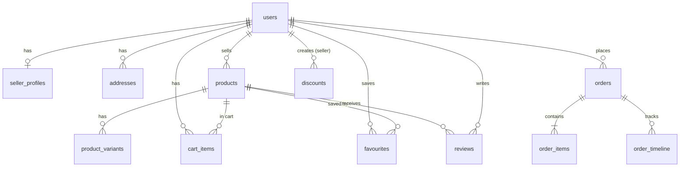

# Atelier Market — PostgreSQL & Docker Edition
> PostgreSQL edition of [Atelier Market (MongoDB edition)](https://github.com/nooremeel/Atelier-Market).

[-10b981?style=for-the-badge&logo=vitest&logoColor=white)](https://github.com/nooremeel/atelier-market-postgres/tree/main/test)
[](https://github.com/nooremeel/atelier-market-postgres/actions/workflows/ci.yml)
[](https://github.com/nooremeel/atelier-market-postgres/tree/main/db)
[](https://github.com/nooremeel/atelier-market-postgres/blob/main/Dockerfile)
[](https://github.com/nooremeel/atelier-market-postgres/tree/main/client)
[](https://github.com/nooremeel/atelier-market-postgres/blob/main/services/paymobService.js)
[](https://github.com/nooremeel/atelier-market-postgres)

**Atelier Market (PostgreSQL Edition)** is an enterprise-grade multi-vendor e-commerce platform and artisanal marketplace engineered to connect master craft studios across the Gulf and Levant regions with global patrons. 

This repository represents an in-depth **architectural data layer migration from MongoDB (document model) to PostgreSQL 16 (ACID-compliant relational model)**, containerized with multi-stage Docker builds, verified via ephemeral PostgreSQL service containers in GitHub Actions CI, and deployed across **Neon** (serverless Postgres), **Render** (containerized API), and **Vercel** (React SPA).

---

## ⚡ 30-Second Client Demo & Persona Switcher

The application features an instant **1-Click Demo Persona Bar** on `/login` and a persistent top-tier demo switcher, allowing technical evaluators to test all three commercial roles with zero friction:

| Persona | Role | Email | Password | Key Capabilities Demonstrated |
| :--- | :--- | :--- | :--- | :--- |
| **Sara Hassan** | **Collector Patron** (Customer) | `sara@example.com` | `Demo1234!` | Browse catalog, select product variants, slide-over mini cart, promo codes, 3-step checkout, Paymob credit card vault (3D-Secure), delivery tracking, dynamic PDF invoices. |
| **Layla Al-Rashidi** | **Artisan Seller** (Multi-Vendor Studio) | `layla@ateliermarket.com` | `Demo1234!` | Studio KPI dashboard, catalog pieces CRUD with inventory thresholds, order fulfillment progression (`crafting` ➔ `shipped` with carrier tracking). |
| **Admin Director** | **Platform Admin** (Director) | `admin@ateliermarket.com` | `Demo1234!` | Marketplace-wide GMV analytics, cross-platform orders monitor, verified artisan directory, catalog audits, system health. |

> **Demo Mode Notice**: Instant demo personas and automatic database seeding/resets are active when `DEMO_MODE=true` is set in the environment. In standard production where `DEMO_MODE=false`, demo resets are disabled to safeguard production data.

---

## 🏛️ Architectural Migration Case Study: MongoDB vs. PostgreSQL

This migration solves real concurrency, scalability, and integrity challenges found in the initial document database implementation:

| Architectural Area | MongoDB MVP Edition | PostgreSQL 16 Edition | Engineering & Business Impact |
| :--- | :--- | :--- | :--- |
| **Inventory & Concurrency** | Unguarded `$inc` updates after order creation. | ACID transaction + conditional `UPDATE ... WHERE stock >= qty` + DB `CHECK` constraint. | Eliminates overselling under high concurrency; prevents negative inventory even under server crashes. |
| **Catalog Search Engine** | Unindexed regex matching (`$regex: new RegExp(q, 'i')`). | Stored generated `tsvector` column + GIN index + `ts_rank` weighted relevance scoring. | Sub-2ms search across title, tags, and description with lexical stemming; eliminates full table scans. |
| **Payment Webhooks** | Non-idempotent order updates. | Transactional conditional update (`WHERE payment_status = 'unpaid'`) checking affected rows count. | 100% idempotent; duplicate Paymob webhook deliveries never result in double stock decrements. |
| **Data Normalization** | Embedded document arrays (`cart.items[]`, `addresses[]`, `favourites[]`). | Normalized 3NF tables with Foreign Keys (`ON DELETE CASCADE/RESTRICT`) and partial unique indexes. | Guarantees relational integrity; enforces exactly one default address per user via partial unique index. |
| **Session Persistence** | `connect-mongodb-session` | `connect-pg-simple` storing encrypted sessions directly in PostgreSQL. | Single database engine for data + sessions, reducing connection overhead and infrastructure cost. |
| **Automated Testing & CI** | In-memory MongoDB mock (`MongoMemoryServer`). | Ephemeral PostgreSQL service container (`postgres:16-alpine`) in GitHub Actions CI. | Full environment parity; tests validate actual PostgreSQL constraints, locking, and migrations. |

---

## 📊 Entity-Relationship (ER) Diagram



---

## 💎 Core Engineering Highlights

### 1. Zero-Overselling Concurrency Protection
In a flash sale or high-traffic marketplace, multiple buyers may attempt to purchase the last available stock simultaneously. The PostgreSQL edition guarantees zero overselling through defense-in-depth:
- **Lock Ordering:** Order items are sorted deterministically by product ID before locking, preventing deadlocks between concurrent checkouts.
- **Atomic Guarded Update:**
  ```sql
  UPDATE products
  SET stock = stock - :quantity, updated_at = NOW()
  WHERE id = :productId AND stock >= :quantity
  RETURNING id, stock;
  ```
  If zero rows are updated, the checkout detects stock exhaustion immediately, rolls back the transaction, and returns HTTP 409.
- **Database CHECK Constraint:** `ALTER TABLE products ADD CONSTRAINT check_stock_non_negative CHECK (stock >= 0);` ensures negative stock is physically impossible at the storage engine level.
- **Concurrency Test Suite:** Verified via [`test/api/orders.concurrency.test.js`](test/api/orders.concurrency.test.js), executing 20 concurrent simulated checkouts on an item with 5 units of stock (exactly 5 succeed, 15 fail with 409, final stock is exactly 0).

### 2. Lexical Full-Text Search with GIN Indexing & `ts_rank`
Replaced unindexed regex scans with PostgreSQL's native lexical search engine:
- **Stored Generated Column:** Combines `title` (weight A: 1.0), `tags` (weight B: 0.4), and `description` (weight C: 0.2) into a pre-computed `search_vector`.
- **GIN (Generalized Inverted Index):** Inverted index maps normalized lexemes to tuple pointers, providing sub-2ms query execution.
- **Websearch Parser:** Supports natural queries with phrases (`"handmade leather"`), exclusions (`-ceramic`), and boolean ORs via `websearch_to_tsquery`.
- **Query Plan Benchmark:** Documented in [`docs/PERFORMANCE.md`](docs/PERFORMANCE.md) with `EXPLAIN (ANALYZE, BUFFERS)` showing `Bitmap Index Scan` with 0 disk reads.

### 3. Paymob Payment Gateway & Idempotent Webhooks
- **3D-Secure Financial Pipeline:** Integrates Paymob auth token generation, merchant order registration in piasters (cents), payment key issuance, and bank 3DS redirection.
- **Luxury Payment Vault Modal:** Interactive credit card preview with real-time Luhn algorithm validation, card brand detection (Visa, Mastercard, Amex), and full RTL/LTR isolation.
- **HMAC-SHA512 Webhook Verification:** Server-to-server webhook verified against Paymob's 20-field lexical ordering signature.
- **Idempotent Webhook Fulfillment:** Status transitions execute conditionally (`WHERE payment_status = 'unpaid'`). Duplicate webhook deliveries return HTTP 200 without double-decrementing inventory.

---

## 🧪 Automated Test Suite (288 Tests · 100% Pass)

The application maintains comprehensive test coverage across both backend services and frontend React components:

```bash
# Run backend PostgreSQL integration & concurrency tests (19 test files, 115 tests)
npm test

# Run frontend React component & hook tests (55 test files, 173 tests)
npm --prefix client test

# Run TypeScript strict typecheck & production client build
npm run build
```

---

## 🚀 Local Development Setup

### Option A: Docker Compose (Recommended)
Boot the entire stack (PostgreSQL database, test database, and containerized API) with one command:

```bash
# 1. Clone the repository
git clone https://github.com/nooremeel/atelier-market-postgres.git
cd atelier-market-postgres

# 2. Configure environment
cp .env.example .env

# 3. Start containers
docker compose up --build
```
The application will boot on `http://localhost:3001` with migrations and demo data seeded automatically.

### Option B: Local Node.js & PostgreSQL
```bash
# 1. Install dependencies
npm install

# 2. Run migrations
npx sequelize-cli db:migrate

# 3. Seed demo accounts & catalog
npm run db:seed

# 4. Start backend & frontend dev servers
npm run dev        # Backend Express API (port 3001)
npm run client:dev # Frontend Vite dev server (port 5173 with proxy)
```

---

## ☁️ Production Cloud Deployment Architecture

The production architecture separates compute and storage across specialized, cost-effective cloud services:

```text
┌─────────────────────────────────┐
│     Client Browser (User)       │
└────────────────┬────────────────┘
                 │
                 ▼
┌─────────────────────────────────┐
│     Vercel Edge Network         │
│  - Hosts React 18 SPA           │
│  - Rewrites /api/* ─────────────┼────────┐
│  - Keeps Same-Origin Cookies    │        │
└─────────────────────────────────┘        │ (Reverse Proxy)
                                           ▼
                       ┌──────────────────────────────────────┐
                       │     Render Web Service               │
                       │  - Multi-stage Docker Container      │
                       │  - Express 5 REST API                │
                       │  - Runs migrations on startup        │
                       └──────────────────┬───────────────────┘
                                          │
                                          ▼
                       ┌──────────────────────────────────────┐
                       │     Neon Serverless PostgreSQL       │
                       │  - PostgreSQL 16 engine              │
                       │  - Connection pooling (PgBouncer)    │
                       │  - Direct connection for migrations  │
                       └──────────────────────────────────────┘
```

### Why the Vercel Reverse-Proxy Rewrite Matters
By routing `/api/(.*)` requests through Vercel's rewrite proxy (`vercel.json`), the browser only communicates with the single Vercel domain. This architecture preserves **same-origin cookie security** (`SameSite=Lax`), prevents third-party cookie blocking in Safari/Chrome, and eliminates cross-origin CORS/preflight overhead.

---

## 📁 Repository Directory Structure

```text
atelier-market-postgres/
├── .github/workflows/ci.yml    # CI pipeline with PostgreSQL 16 service container
├── client/                     # React 18 + TypeScript SPA (Strict mode, Vite)
├── controllers/                # Thin Express REST controllers
├── db/                         # PostgreSQL database layer
│   ├── config.js               # Sequelize environment database connections
│   ├── index.js                # Model associations & connection exports
│   ├── migrations/             # 7 Raw SQL versioned migrations (001 to 007)
│   └── models/                 # Sequelize model definitions (User, Product, Order, etc.)
├── docs/                       # Migration specs and performance benchmarks
│   └── PERFORMANCE.md          # EXPLAIN ANALYZE execution plans & GIN benchmarks
├── middleware/                 # Reusable Express middleware (auth, RBAC, CSRF, rate-limit)
├── routes/                     # Express route mounts
├── scripts/                    # Maintenance & seeding scripts (seed.js)
├── services/                   # Decoupled business logic domain services
├── test/                       # Backend test suite (Vitest + Supertest + Concurrency)
├── Dockerfile                  # Multi-stage, non-root Alpine container build
├── docker-compose.yml          # Local multi-container development environment
├── render.yaml                 # Render Blueprint deployment definition
├── vercel.json                 # Vercel SPA build & reverse-proxy configuration
└── server.js                   # Minimal server bootstrap (~65 lines)
```

---

## ⚖️ License
This project is licensed under the [ISC License](package.json).
